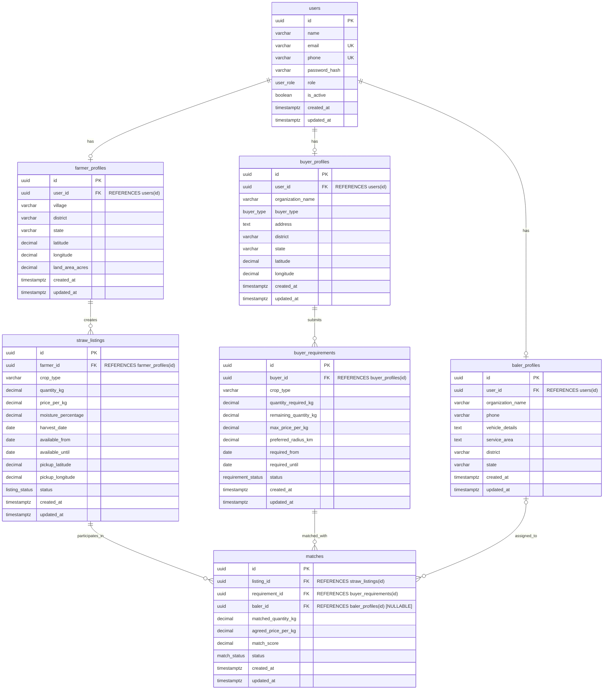
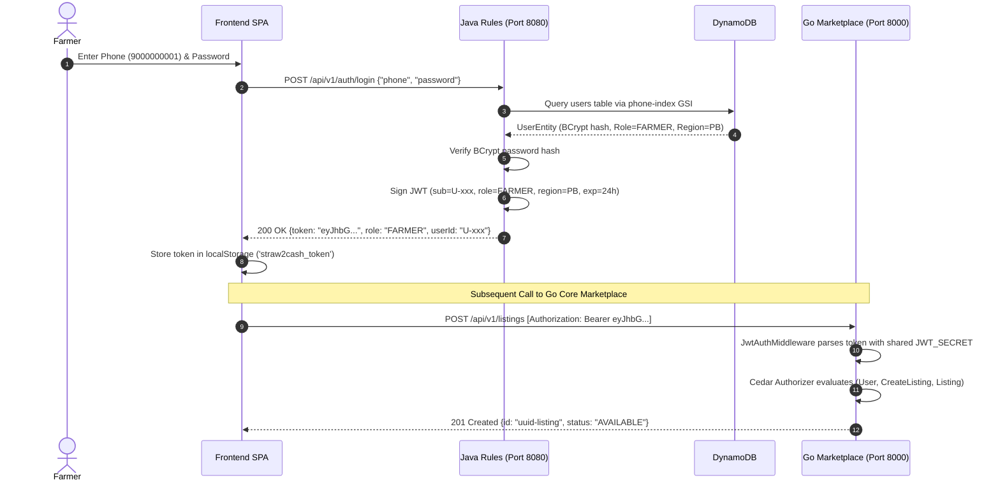
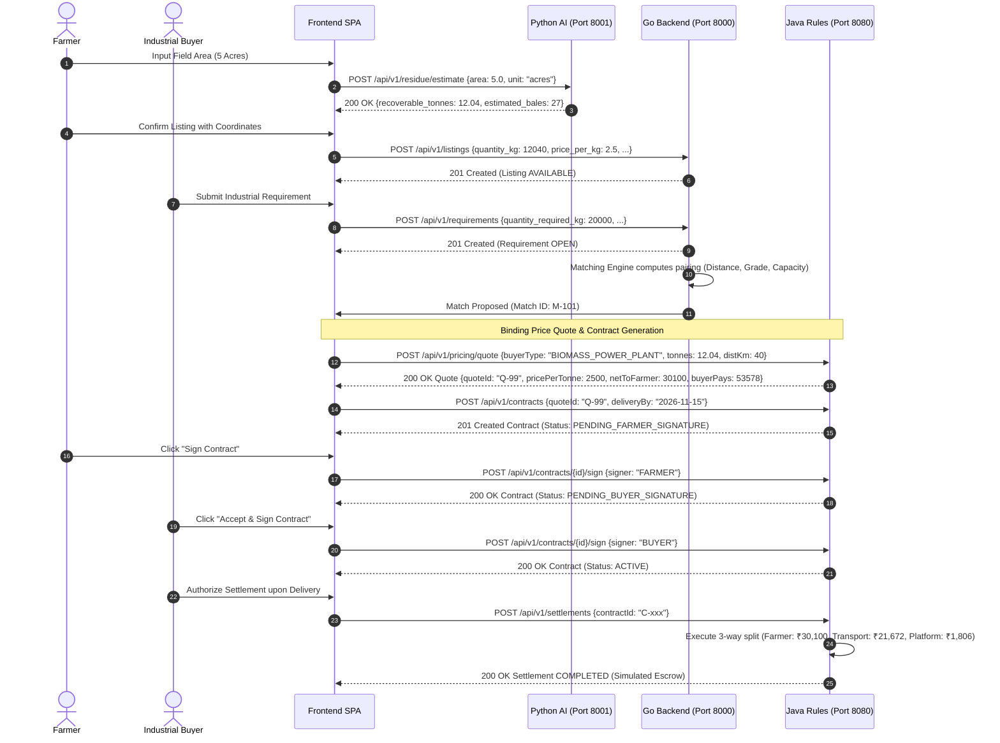
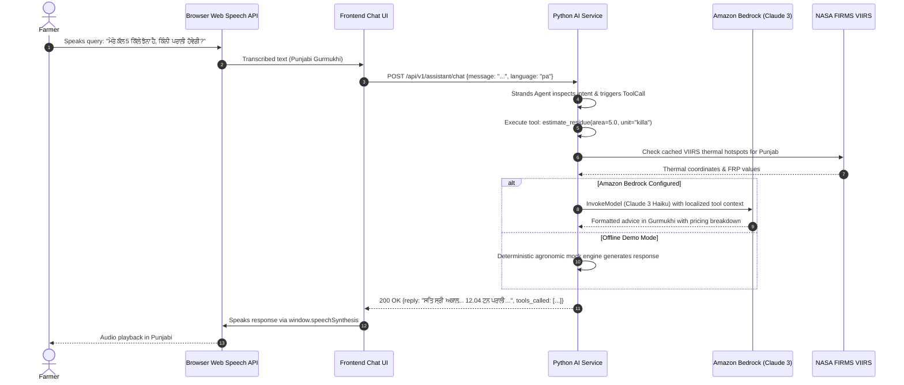

# Straw2Cash (Parali Exchange) — Turning Crop Residue into Income

> **Bharat Builds Hackathon | Team The Boys**  
> *Category: Agriculture, Sustainability, Climate Technology, AI, and Digital Marketplaces*

[](https://github.com/DAbharat/Straw2Cash)
[](go-backend/)
[](rules-service/)
[](python-ai/)
[](frontend/)
[](go-backend/internal/authz/)
[](rules-service/docs/08-deployment.md)

---

## Executive Summary

Every autumn across northern India, particularly in Punjab and Haryana, farmers harvest millions of hectares of paddy. Left with short turnaround windows (10–15 days) before sowing wheat, farmers face prohibitive baling and transport costs. With few accessible market linkages, crop residue is burned in open fields, creating hazardous smog blankets across the Indo-Gangetic plain, depleting soil biology, and wasting millions of tonnes of combustible biomass.

Concurrently, industries—including **biomass power plants, brick kilns, paper mills, and cattle-feed manufacturers**—face persistent raw-material supply bottlenecks and volatile procurement networks.

**Straw2Cash (Parali Exchange)** is an end-to-end digital marketplace designed to bridge this divide. By transforming loose paddy straw into guaranteed economic income, Straw2Cash aligns economic self-interest with clean air:

1. **Farmers** estimate their field tonnage using scientific ICAR/PAU models, list straw with GPS coordinates, receive guaranteed transparent pricing, and sign binding purchase contracts.
2. **Industrial Buyers** submit aggregate seasonal demand requirements, discover nearby verified residue clusters, and execute multi-party supply contracts.
3. **Baler Operators** receive custom-hiring dispatch assignments to harvest, compress, and haul straw without leaving the logistics burden on smallholders.
4. **Pollution Authorities & Policymakers** monitor real-time satellite fire risks (NASA FIRMS VIIRS) and audit cumulative CO₂ emissions avoided and farmer revenue generated.

---

## System Architecture

Straw2Cash is engineered as a polyglot distributed system where each service owns distinct business, data, and security boundaries.

### Architectural Diagram

```mermaid
flowchart TB
    subgraph Clients["User Tier (Frontend & Clients)"]
        Farmer["Farmer\n(Mobile/Web)"]
        Buyer["Industrial Buyer\n(Power/Kiln/Mill/Feed)"]
        Baler["Baler Operator\n(Custom Hiring)"]
        Authority["Pollution Authority\n(State Board)"]
        WebUI["React 19 + TypeScript SPA\n(Vite 8, Tailwind CSS v4, Maps)\nPort 5173 / 3000"]
    end

    Farmer -->|HTTP / JWT| WebUI
    Buyer -->|HTTP / JWT| WebUI
    Baler -->|HTTP / JWT| WebUI
    Authority -->|HTTP / JWT| WebUI

    subgraph AWS_Cloud["AWS Cloud & Managed Infrastructure Boundary"]
        subgraph Java_Rules["Java Rules Service (Member 2) — Port 8080"]
            SpringBoot["Spring Boot 3.4.1 (Java 21)\nSecurity 6.4 + JJWT 0.12.6"]
            PricingEng["Pricing Engine\n(Table-Driven Matrix)"]
            ContractSM["Contract State Machine\n(Dual Digital Signatures)"]
            SettlementEng["Escrow Settlement Engine\n(3-Way Simulated Split)"]
            ImpactEng["Impact Analytics\n(IPCC / ICAR CO₂e Avoided)"]
        end

        subgraph AWS_Storage["AWS Storage & Analytics"]
            DynamoDB[("Amazon DynamoDB\n• price_rules\n• quotes\n• contracts (GSI: farmerId)\n• settlements (GSI: contractId)\n• users (GSI: phone)")]
            S3["Amazon S3\n(Contracts Bucket - Configured)"]
            SNS["Amazon SNS\n(Contract Events - Configured)"]
        end

        subgraph AWS_AI["AWS AI & Foundation Models"]
            Bedrock["Amazon Bedrock\nClaude 3 Haiku (Configured)\nap-south-1 Mumbai"]
            Transcribe["Amazon Transcribe\n(Speech-to-Text — Planned)"]
            Polly["Amazon Polly\n(Text-to-Speech — Planned)"]
        end
    end

    subgraph Core_Marketplace["Go Marketplace Backend (Member 1 — Bharat) — Port 8000 / 9000"]
        GoServer["Go HTTP Server (Gorilla Mux)\nLayered Architecture"]
        MatchingEng["Matching Engine\n(Proximity & Grade Scoring)"]
        ListingSvc["Listing & Profile Management\n(Farmer, Buyer, Baler)"]
        CedarEngine["Cedar Policy Engine (cedar-go v1.8.0)\nFine-Grained ABAC / RBAC Authorization"]
        PostgresDB[("PostgreSQL 17 (pgxpool + sqlc)\n• users\n• farmer_profiles\n• buyer_profiles\n• baler_profiles\n• straw_listings\n• buyer_requirements\n• matches")]
    end

    subgraph Python_Intelligence["Python AI/ML Service (Member 3) — Port 8001"]
        FastAPI["FastAPI 0.110 (Uvicorn)\nPydantic v2 Settings"]
        ResidueCalc["Agronomic Residue Estimator\n(ICAR / PAU / TIFAC Coefficients)"]
        FirmsClient["NASA FIRMS Ingestion Engine\n(VIIRS NOAA-20 / SNPP Active Fires)"]
        BurnRisk["Geospatial Burn-Risk Scoring\n(GeoJSON FeatureCollection)"]
        StrandsAssistant["Multilingual Strands Agent\n(Hindi / Punjabi / English Tools)"]
        BrowserSpeech["Client-Side Web Speech API\n(Synthesis & Recognition Fallback)"]
    end

    %% Client Interactions
    WebUI -->|1. Auth & Registration (JWT)| SpringBoot
    WebUI -->|2. Listings, Profiles, Matches| GoServer
    WebUI -->|3. Residue Calc, Hotspots, Assistant| FastAPI
    WebUI -->|4. Quotes, Contracts, Settlements| SpringBoot

    %% Service Boundaries & Data Storage
    SpringBoot -->|Enhanced Client SDK v2| DynamoDB
    SpringBoot -.->|Event Notification| SNS
    SpringBoot -.->|PDF Storage| S3
    GoServer -->|Queries / Transactions| PostgresDB
    GoServer -->|Evaluates Policies| CedarEngine
    FastAPI -->|Boto3 InvokeModel| Bedrock
    FastAPI -->|HTTPS Satellite Feed| FirmsClient
    FastAPI -.->|Indicative Price Sync| SpringBoot
    FastAPI -.->|Requirement Volume Sync| GoServer

    %% Voice Fallback
    WebUI -.->|Speech Synthesis & STT| BrowserSpeech
    BrowserSpeech -.->|Planned AWS Migration| Transcribe
    BrowserSpeech -.->|Planned AWS Migration| Polly
```

---

## Critical Architecture Rule: Java Owns Authentication

To maintain strict financial compliance, account segregation, and single-source-of-truth identity management:

1. **Authentication Ownership**: The Java backend (`rules-service`) owns authoritative user registration, credential verification, BCrypt password hashing, role lifecycle management (`FARMER`, `BUYER`, `AUTHORITY`, `BALER_OPERATOR`), and issuance of 24-hour stateless JWT tokens signed via HMAC-SHA256 (`POST /api/v1/auth/login`, `POST /api/v1/users/register`, `GET /api/v1/users/me`).
2. **Data Ownership**: Authentication records reside in Amazon DynamoDB (`users` table, indexed by `userId` partition key and a `phone-index` Global Secondary Index).
3. **Decoupled Authorization via Cedar**: The Go backend does **not** manage primary user credentials. Instead, Go acts as the core marketplace and dispatch engine. Go verifies incoming JWT Bearer tokens and delegates policy decisions to **Cedar** (`github.com/cedar-policy/cedar-go`), an open-source policy-based authorization language.

### Authentication vs. Authorization Distinction

| Concern | Responsibility | Implemented Mechanism | Service |
|---|---|---|---|
| **Authentication (AuthN)** | Verifying **who the user is** | Phone number + BCrypt password hash, JWT issuance (HMAC-SHA256, 24h expiry) | **Java Backend** (`rules-service`) |
| **Authorization (AuthZ)** | Determining **what the user is permitted to do** | Policy-based access evaluation via formal Cedar policy statements (`profile.cedar`) | **Go Backend** (`internal/authz`) |
| **Role-Based Routing** | Determining permitted UI views and contract actions | Spring Security method security & `SecurityConfig` role matching | **Java Backend** |

> **Note on Cedar**: Cedar is an **open-source authorization policy engine**, not an identity provider. It evaluates requests of the form `(principal, action, resource, context)` against declarative rules (e.g., verifying that only users with the `FARMER` role can invoke `Action::"CreateListing"` and only the record's creator can execute `Action::"ManageListing"`).

---

## Backend Services & Responsibilities

### A. Go Backend — Core Marketplace & Matching Engine
* **Port:** `8000` (Local) / `9000` (Container)
* **Technology:** Go 1.22+, Gorilla Mux, pgxpool v5, sqlc, Cedar Policy Go SDK v1.8.0, PostgreSQL 17
* **Architecture Pattern:** Strict 4-layer dependency model: `Router → Handler → Service → Repository → sqlc → PostgreSQL`

#### Key Responsibilities
1. **Listing Management:** Creates and queries crop-residue listings with spatial coordinates (`pickup_latitude`, `pickup_longitude`), harvest dates, moisture percentages, and residue types.
2. **Buyer Requirements:** Captures seasonal industrial demand with max price thresholds and acquisition radiuses.
3. **Matching Engine:** Computes candidate pairings between farmer listings and buyer requirements using geospatial proximity, volume compatibility, and pricing parameters.
4. **Baler Coordination:** Registers baler fleet profiles (`baler_profiles`) including tractor/baler equipment details and operational service districts.
5. **Policy Enforcement:** Evaluates Cedar authorization rules before committing mutations to PostgreSQL.

---

### B. Java Backend — Rules, Contracts, & Settlements (`rules-service`)
* **Port:** `8080`
* **Technology:** Java 21, Spring Boot 3.4.1, Spring Security 6.4, AWS SDK v2 (DynamoDB Enhanced Client, SNS, S3), JJWT 0.12.6, BCrypt, Docker
* **Architecture Pattern:** `Controller → Service → Repository → DynamoDbEnhancedClient`

#### Key Responsibilities
1. **Identity & AuthN Authority:** Issues and validates JWT tokens for all primary actors. Seeds initial demo credentials on cold start.
2. **Pricing Engine:** Computes deterministic, binding prices per tonne based on industrial buyer type, moisture deduction tiers, grade adjustments, and haulage distances. **Guarantees that logistics costs are borne by the buyer and never deducted from farmer earnings.**
3. **Contract Lifecycle:** Orchestrates the multi-party contract state machine:
   $$\text{Draft} \longrightarrow \text{Pending Farmer Signature} \longrightarrow \text{Pending Buyer Signature} \longrightarrow \text{Active} \longrightarrow \text{Completed}$$
4. **Escrow & Settlement Simulation:** Simulates an idempotent 3-way money transfer:
   $$\text{Buyer Escrow} \longrightarrow \begin{cases} \text{Farmer Net Earnings} \\ \text{Transporter Logistics Fee} \\ \text{Platform Service Fee (6\%)} \end{cases}$$
5. **Impact Analytics:** Aggregates regional residue diverted from open combustion and computes CO₂e abatement using scientific emission factors ($1.5\,\text{t CO}_2\text{e}$ per tonne of burned straw).

---

### C. Python AI/ML & Intelligence Backend (`python-ai`)
* **Port:** `8001`
* **Technology:** Python 3.11+, FastAPI 0.110, Pydantic v2, Strands Agents SDK, HTTPX, Boto3 (Bedrock), Pytest
* **Status:** Feature-complete (29/29 passing tests)

#### Key Responsibilities
1. **Agronomic Residue Estimation:** Implements deterministic calculations based on ICAR (Indian Council of Agricultural Research) and PAU (Punjab Agricultural University) field baselines:
   $$\text{Gross Straw} = \text{Area (ha)} \times \text{Grain Yield (6.2 t/ha)} \times \text{Residue-to-Product Ratio (1.2)}$$
   $$\text{Recoverable Straw} = \text{Gross Straw} \times \text{Mechanized Baler Efficiency (80\%)}$$
   $$\text{Standard Round Bales} = \frac{\text{Recoverable Straw (kg)}}{450\,\text{kg/bale}}$$
2. **NASA FIRMS Satellite Fire Intelligence:** Ingests thermal anomaly coordinates from NASA's VIIRS satellites (NOAA-20 / SNPP) within the Punjab/Haryana bounding box ($29.5^\circ\text{N} - 32.5^\circ\text{N},\, 74.0^\circ\text{E} - 77.0^\circ\text{E}$). Caches feeds with a 30-minute TTL and falls back to deterministic offline fixtures if credentials are unset.
3. **Geospatial Burn-Risk Zones:** Synthesizes Fire Radiative Power (FRP in MW), cluster detection density, seasonal harvest windows, and lack of registered Straw2Cash listings into standardized GeoJSON `FeatureCollection` risk polygons.
4. **Multilingual AI Assistant:** Built on the Strands Agents SDK, enabling conversation in **Hindi (`hi`)**, **Punjabi (`pa` Gurmukhi)**, and **English (`en`)**. Automatically binds tools for residue calculation, market prices, demand lookup, and nearby fire hotspots. Configured for Amazon Bedrock (Claude 3 Haiku) with offline mock fallbacks.
5. **Interactive Demo Bench:** Standalone web interface hosted at `http://localhost:8001/demo` for end-to-end testing of speech synthesis, satellite fire maps, and live residue calculations.

---

### D. Frontend Single Page Application (`frontend`)
* **Port:** `5173` (Vite) / `3000` (Production Container)
* **Technology:** React 19, TypeScript, Vite 8, Tailwind CSS v4, Lucide React, Motion (Framer), Axios
* **Architecture:** Component-driven SPA with client-side history routing, unified Axios interceptors with Bearer token injection, and error normalization across all three backends.

#### Implemented User Dashboards
* **Farmer Dashboard (`/dashboard`, `/farmer/*`):** Residue calculator, listing submission with GPS coordinates, match discovery, and contract signing.
* **Buyer Marketplace (`/buyer/*`):** Browsing verified straw listings, submitting demand requirements, reviewing farmer matches, and initiating settlements.
* **Baler Service Hub (`/baler/*`):** Custom-hiring profile, vehicle specifications, and assigned baling dispatch jobs.
* **Pollution Authority Portal (`/fire-risks`, `/impact`):** Interactive satellite hotspot map and state-level CO₂ abatement dashboard.
* **Conversational Assistant (`/assistant`):** Multi-turn speech and text chat in Hindi, Punjabi, and English.

---

## AWS Cloud Services & Open-Source Integration

| Technology | Classification | Project Status | Role & Implementation Details |
|---|---|---|---|
| **Amazon DynamoDB** | Managed Cloud NoSQL | **Implemented & Verified** | Primary datastore for the Java Rules backend. 5 tables provisioned (`price_rules`, `quotes`, `contracts`, `settlements`, `users`) with pay-per-request billing, composite keys, and GSIs. Tested locally with `amazon/dynamodb-local`. |
| **Amazon Bedrock** | Managed Cloud GenAI | **Configured & Implemented** | Powers the Strands Agents multilingual assistant. Model target: `anthropic.claude-3-haiku-20240307-v1:0` in `ap-south-1` (Mumbai). Includes fallback to local mock engine or Ollama. |
| **Cedar** | Open-Source Software | **Implemented & Verified** | Policy-based authorization language (developed by AWS, open-sourced). Embedded directly in the Go backend via `cedar-go v1.8.0`. Enforces ABAC/RBAC on profiles, listings, and matches. |
| **Amazon SNS** | Managed Cloud Messaging | **Configured** | Configured in Java `application.yml` (`aws.sns.contract-events-topic-arn`) for publishing contract creation and signature events. |
| **Amazon S3** | Managed Object Storage | **Configured** | Configured in Java `application.yml` (`strawmarket-contracts-local`) for generated PDF contract archival. |
| **Amazon App Runner / Lambda** | Managed Compute | **Configured / Ready** | Production deployment artifacts created in `rules-service/Dockerfile` (Amazon Corretto 21 Alpine) and detailed in deployment documentation (`rules-service/docs/08-deployment.md`). |
| **Amazon Transcribe** | Managed Cloud STT | **Planned Future Work** | Speech-to-text. The current working demo utilizes client-side Browser Web Speech API (`SpeechRecognition`) as an interim zero-cost solution. |
| **Amazon Polly** | Managed Cloud TTS | **Planned Future Work** | Text-to-speech. The current working demo utilizes client-side Browser Web Speech API (`speechSynthesis`) as an interim zero-cost solution. |
| **Amazon Cognito** | Managed Identity | **Planned Future Work** | The Java JWT token claims structure (`sub`, `role`, `region`, `exp`) is explicitly modeled on Cognito ID token schemas for zero-code migration. |

---

## Database Design & Entity Relationships

### Relational Database: PostgreSQL 17 (Go Backend)

The Go backend uses PostgreSQL for transactional marketplace operations requiring spatial filtering, foreign-key cascade integrity, and complex queries managed via `sqlc`.



---

### NoSQL Database: Amazon DynamoDB (Java Rules Service)

The Java Rules service uses DynamoDB for high-throughput, key-value, and document workloads with immutable financial audit trails and secondary index querying.

```
┌────────────────────────────────────────────────────────────────────────────────────────────────────────┐
│ Amazon DynamoDB Table Schema & Access Patterns                                                         │
├──────────────────┬─────────────────┬─────────────────┬──────────────────────┬──────────────────────────┤
│ Table Name       │ Partition Key   │ Sort Key        │ Global Sec. Index    │ Primary Access Patterns  │
├──────────────────┼─────────────────┼─────────────────┼──────────────────────┼──────────────────────────┤
│ price_rules      │ buyerType (S)   │ version (S)     │ —                    │ Fetch active rate rule   │
│ quotes           │ quoteId (S)     │ —               │ —                    │ Retrieve price quote     │
│ contracts        │ contractId (S)  │ —               │ farmerId-index (S)   │ Get contract by ID or    │
│                  │                 │                 │ (PK: farmerId)       │ query farmer's contracts │
│ settlements      │ settlementId (S)│ —               │ contractId-index (S) │ Idempotent settlement    │
│                  │                 │                 │ (PK: contractId)     │ lookup by contract ID    │
│ users            │ userId (S)      │ —               │ phone-index (S)      │ Find user by ID or login │
│                  │                 │                 │ (PK: phone)          │ lookup by phone number   │
└──────────────────┴─────────────────┴─────────────────┴──────────────────────┴──────────────────────────┘
```

#### Cross-Service Data Ownership & Consistency
* **No Database Synchronization:** PostgreSQL and DynamoDB do **not** run automated cross-database replication. Each database is owned exclusively by its respective service.
* **Identifier References:** Services correlate records through standardized string and UUID identifiers passed via API payloads (`farmerId`, `buyerId`, `quoteId`, `contractId`).
* **Source of Truth:**
  * User Identity & Roles $\rightarrow$ DynamoDB (`rules-service`)
  * Crop Listings & Geospatial Matches $\rightarrow$ PostgreSQL (`go-backend`)
  * Legally Binding Contracts & Money Flow $\rightarrow$ DynamoDB (`rules-service`)
  * Satellite Detections & Biomass Estimates $\rightarrow$ In-Memory Cache / Ephemeral (`python-ai`)

---

## End-to-End System Sequence Flows

### Diagram A: Registration & Authentication Flow
Shows how user identity is established in the Java backend and subsequently verified across Go and Python APIs.



---

### Diagram B: Crop-Residue Marketplace & Contract Workflow
Demonstrates how listing creation, buyer matching, pricing calculation, dual signatures, and escrow settlement flow through the services.



---

### Diagram C: AI Assistant & Geospatial Intelligence Workflow
Shows how satellite telemetry, agronomic models, conversational agents, and client-side speech processing interact.



---

## Complete API Reference

### 1. Java Rules, Authentication, & Contracts Service (`Port 8080`)
All authenticated endpoints require `Authorization: Bearer <token>`.

| Method | Endpoint | Purpose | Required Params / Body | Key Response Fields | Auth Required | Status |
|---|---|---|---|---|---|---|
| `GET` | `/api/v1/health` | Service liveness probe | None | `status: "UP"`, `service` | Public | Verified |
| `GET` | `/api/v1/status` | Deep health & DB table counts | None | `tables`, `counts.contracts` | Public | Verified |
| `POST` | `/api/v1/auth/login` | Authenticate user & issue JWT | `phone`, `password` | `token`, `role`, `userId` | Public | Verified |
| `POST` | `/api/v1/users/register` | Register new participant | `phone`, `name`, `password`, `role`, `region` | `userId`, `role`, `phone` | Public | Verified |
| `GET` | `/api/v1/users/me` | Fetch active profile | None | `userId`, `role`, `region` | Bearer Token | Verified |
| `POST` | `/api/v1/pricing/quote` | Calculate binding price quote | `buyerType`, `estimatedTonnes`, `moisturePct`, `grade`, `distanceKm` | `quoteId`, `netToFarmer`, `buyerPays`, `breakdown[]` | Bearer Token | Verified |
| `POST` | `/api/v1/contracts` | Draft contract from quote | `quoteId`, `deliveryBy` | `contractId`, `status: "PENDING_FARMER_SIGNATURE"` | Bearer Token | Verified |
| `POST` | `/api/v1/contracts/{id}/sign` | Sign contract (farmer/buyer) | `signer: "FARMER" \| "BUYER"` | `contractId`, `status: "ACTIVE"` | Bearer Token | Verified |
| `GET` | `/api/v1/contracts/{id}` | Get contract details | Path: `id` | `contractId`, `status`, `tonnes` | Bearer Token | Verified |
| `GET` | `/api/v1/contracts` | List contracts by farmer | Query: `farmerId` | Array of `ContractResponse` | Bearer Token | Verified |
| `POST` | `/api/v1/settlements` | Execute 3-way escrow payout | `contractId` | `settlementId`, `flows[]`, `status: "COMPLETED"` | Role: `BUYER` | Verified |
| `GET` | `/api/v1/settlements/{id}` | Get settlement record | Path: `id` | `settlementId`, `flows[]` | Bearer Token | Verified |
| `GET` | `/api/v1/settlements` | List settlements by contract | Query: `contractId` | Array of `SettlementResponse` | Bearer Token | Verified |
| `GET` | `/api/v1/impact/summary` | Environmental CO₂ audit | Optional Query: `region`, `from`, `to` | `tonnesDiverted`, `co2AvoidedTonnes`, `farmerIncomeINR` | Role: `AUTHORITY` | Verified |

---

### 2. Go Marketplace & Matching Service (`Port 8000`)
All protected endpoints require `Authorization: Bearer <token>` (evaluated via Cedar policies).

| Method | Endpoint | Purpose | Required Params / Body | Key Response Fields | Auth / Policy | Status |
|---|---|---|---|---|---|---|
| `GET` | `/health` | Core marketplace health probe | None | `status: "ok"` | Public | Verified |
| `POST` | `/api/v1/auth/register` | Local Go user registration | `name`, `phone`, `password`, `role` | `token`, `user.id`, `user.role` | Public | Standalone |
| `POST` | `/api/v1/auth/login` | Local Go user login | `phone`, `password` | `token`, `user.id`, `user.role` | Public | Standalone |
| `GET` | `/api/v1/users/me` | Current Go user context | None | `id`, `name`, `phone`, `role` | Bearer Token | Verified |
| `GET` | `/api/v1/users/{id}` | Fetch user by UUID | Path: `id` | `id`, `name`, `phone`, `role` | Bearer Token | Verified |
| `POST` | `/api/v1/farmers/profile` | Create farmer farm profile | `village`, `district`, `state`, `latitude`, `longitude`, `land_area_acres` | `id`, `user_id`, `district` | Cedar: `FARMER` | Verified |
| `GET` | `/api/v1/farmers/profile/me` | Fetch authenticated farmer profile | None | `id`, `village`, `land_area_acres` | Cedar: `ReadProfile` | Verified |
| `PUT` | `/api/v1/farmers/profile` | Update farmer farm profile | Optional fields | `id`, updated profile fields | Cedar: `UpdateProfile` | Verified |
| `POST` | `/api/v1/buyers/profile` | Create industrial buyer profile | `organization_name`, `buyer_type`, `address`, `district`, `state`, coordinates | `id`, `user_id`, `buyer_type` | Cedar: `BUYER` | Verified |
| `GET` | `/api/v1/buyers/profile/me` | Fetch authenticated buyer profile | None | `id`, `organization_name` | Cedar: `ReadProfile` | Verified |
| `POST` | `/api/v1/balers/profile` | Create custom-hiring baler profile | `organization_name`, `phone`, `vehicle_details`, `service_area`, `district`, `state` | `id`, `vehicle_details` | Cedar: `BALER` | Verified |
| `GET` | `/api/v1/balers/profile/me` | Fetch authenticated baler profile | None | `id`, `service_area` | Cedar: `ReadProfile` | Verified |
| `POST` | `/api/v1/listings` | Create straw residue listing | `crop_type`, `quantity_kg`, `price_per_kg`, `moisture_percentage`, `harvest_date`, coordinates | `id`, `farmer_id`, `status: "AVAILABLE"` | Cedar: `CreateListing` | Verified |
| `GET` | `/api/v1/listings` | Browse available listings | Query: `status`, `limit`, `offset` | Array of `ListingResponse` | Bearer Token | Verified |
| `GET` | `/api/v1/listings/{id}` | Fetch listing details | Path: `id` | `id`, `quantity_kg`, `status` | Bearer Token | Verified |
| `PUT` | `/api/v1/listings/{id}/status` | Update listing status | `status: "BOOKED" \| "MATCHED"` | `id`, `status` | Cedar: `ManageListing` | Verified |
| `POST` | `/api/v1/requirements` | Submit buyer demand requirement | `crop_type`, `quantity_required_kg`, `max_price_per_kg`, `preferred_radius_km`, date range | `id`, `buyer_id`, `status: "OPEN"` | Cedar: `CreateRequirement` | Verified |
| `GET` | `/api/v1/requirements` | List active buyer requirements | Query: `status`, `limit`, `offset` | Array of `RequirementResponse` | Bearer Token | Verified |
| `GET` | `/api/v1/requirements/{id}` | Fetch requirement details | Path: `id` | `id`, `quantity_required_kg` | Bearer Token | Verified |
| `PUT` | `/api/v1/requirements/{id}/status` | Update requirement status | `status: "FULFILLED"` | `id`, `status` | Cedar: `ManageRequirement` | Verified |
| `POST` | `/api/v1/matches` | Create listing-requirement pairing | `listing_id`, `requirement_id`, `matched_quantity_kg`, `agreed_price_per_kg` | `id`, `match_score`, `status: "PROPOSED"` | Cedar: `CreateMatch` | Verified |
| `GET` | `/api/v1/matches/{id}` | Fetch match details | Path: `id` | `id`, `status`, `match_score` | Bearer Token | Verified |
| `PUT` | `/api/v1/matches/{id}/status` | Accept or reject match proposal | `status: "ACCEPTED" \| "REJECTED"` | `id`, `status` | Cedar: `ManageMatch` | Verified |

---

### 3. Python AI/ML & Intelligence Service (`Port 8001`)

| Method | Endpoint | Purpose | Required Params / Body | Key Response Fields | Auth Required | Status |
|---|---|---|---|---|---|---|
| `GET` | `/api/v1/health` | AI/ML service liveness check | None | `status: "OK"`, `models` | Public | Verified |
| `GET` | `/demo` | Standalone interactive UI bench | None | HTML / Webpage | Public | Verified |
| `POST` | `/api/v1/residue/estimate` | Agronomic residue estimation | `area`, `area_unit` (`acres`, `killa`, `hectares`, `bigha`), `crop_type`, `region` | `gross_residue_tonnes`, `recoverable_residue_tonnes`, `estimated_bales`, `confidence_range` | Public | Verified |
| `GET` | `/api/v1/hotspots` | Raw satellite thermal anomalies | Query: `days`, `min_lat`, `min_lon`, `max_lat`, `max_lon` | `hotspots[]`, `count`, `data_source` | Public | Verified |
| `GET` | `/api/v1/hotspots/summary` | Aggregated regional fire summary | None | `total_active_detections`, `peak_frp_mw` | Public | Verified |
| `GET` | `/api/v1/hotspots/risk-zones` | Geospatial burn-risk polygons | None | GeoJSON `FeatureCollection` (`Point` features with `risk_score`, `risk_level`) | Public | Verified |
| `POST` | `/api/v1/assistant/chat` | Multilingual conversational agent | `message`, `language` (`hi`, `pa`, `en`), `session_id` | `reply`, `detected_language`, `tools_called[]`, `provider_used` | Public | Verified |
| `GET` | `/api/v1/insights/demand` | Aggregated regional demand | Query: `region`, `radius_km` | `total_demand_tonnes`, `industry_breakdown[]` | Public | Verified |
| `GET` | `/api/v1/insights/prices` | Indicative price baseline feed | None | `indicative_rates[]`, `disclaimer` | Public | Verified |

---

## Tech Stack Summary

```
┌───────────────────┬────────────────────────────────────────────────────────────────────────┐
│ Layer             │ Technologies & Exact Versions                                          │
├───────────────────┼────────────────────────────────────────────────────────────────────────┤
│ Frontend SPA      │ React 19.0.1, TypeScript 5.8+, Vite 8.3.0, Tailwind CSS 4.3.3,         │
│                   │ Axios 1.20, Lucide React 0.546, Motion 12.23 (Framer), GSAP 3.15       │
├───────────────────┼────────────────────────────────────────────────────────────────────────┤
│ Go Marketplace    │ Go 1.22+ (go.mod: 1.26), Gorilla Mux 1.8.1, Jackc pgxpool v5.11.0,     │
│                   │ Cedar Policy Go SDK 1.8.0, Golang-JWT v5.3.1, Golang Crypto 0.57       │
├───────────────────┼────────────────────────────────────────────────────────────────────────┤
│ Java Rules & Money│ Java 21 LTS (Corretto), Spring Boot 3.4.1, Spring Security 6.4.2,      │
│                   │ AWS SDK v2 2.28.16 (DynamoDB Enhanced, SNS, S3), JJWT 0.12.6, Maven 3.9│
├───────────────────┼────────────────────────────────────────────────────────────────────────┤
│ Python AI/ML      │ Python 3.11+, FastAPI 0.110, Pydantic 2.6, Pydantic-Settings 2.2,       │
│                   │ Strands Agents SDK 1.50, HTTPX 0.27, Boto3, Pytest 8.0                │
├───────────────────┼────────────────────────────────────────────────────────────────────────┤
│ Persistence       │ PostgreSQL 17 (Relational Marketplace), Amazon DynamoDB (NoSQL Rules)  │
├───────────────────┼────────────────────────────────────────────────────────────────────────┤
│ Security & Policy │ HMAC-SHA256 JWT, BCrypt, Cedar Declarative Policy Language (ABAC/RBAC) │
├───────────────────┼────────────────────────────────────────────────────────────────────────┤
│ Geospatial & Data │ NASA FIRMS VIIRS (NOAA-20/SNPP), GeoJSON, ICAR/PAU Agronomic Atlas     │
├───────────────────┼────────────────────────────────────────────────────────────────────────┤
│ Containerization  │ Docker, Docker Compose (PostgreSQL 17, DynamoDB Local)                 │
└───────────────────┴────────────────────────────────────────────────────────────────────────┘
```

---

## Project Structure

```text
Straw2Cash/
├── README.md                           # Master hackathon showcase documentation
├── frontend/                           # React 19 + TypeScript SPA
│   ├── package.json                    # Frontend dependencies (React 19, Tailwind v4, Vite 8)
│   ├── vite.config.ts                  # Vite build and development configuration
│   ├── index.html                      # Single page application HTML entry point
│   ├── docs/
│   │   └── frontend-guide.md           # Frontend developer integration guide
│   └── src/
│       ├── main.tsx                    # React application bootstrap
│       ├── App.tsx                     # Master routing, layout wrapper & middleware
│       ├── api/client.ts               # Configured Axios instances (Java, Go, Python)
│       ├── lib/
│       │   ├── api/                    # Service-specific API wrappers (goService, javaService)
│       │   └── context/                # React context providers (AuthContext, ToastContext)
│       ├── pages/                      # Role-specific views
│       │   ├── LandingPage.tsx         # Public marketing & problem overview
│       │   ├── LoginPage.tsx           # Multi-role sign-in
│       │   ├── RegisterPage.tsx        # Multi-role account registration
│       │   ├── DashboardPage.tsx       # Primary operational console
│       │   ├── FireRiskMapPage.tsx     # Satellite thermal hotspot visualization
│       │   ├── AssistantPage.tsx       # Multilingual AI assistant interface
│       │   ├── farmer/                 # Listings, matches & residue calculator
│       │   ├── buyer/                  # Industrial marketplace & demand requirements
│       │   ├── baler/                  # Custom-hiring fleet profiles & dispatch jobs
│       │   └── contracts/              # Quotes, digital contracts & simulated settlements
│       └── components/                 # Reusable UI elements (cards, navigation, modals)
│
├── go-backend/                         # Go 1.22+ Core Marketplace & Matching Engine
│   ├── go.mod                          # Go module dependencies (Gorilla Mux, pgxpool, Cedar)
│   ├── docker-compose.yml              # Local PostgreSQL 17 container configuration
│   ├── cmd/
│   │   └── api/main.go                 # Go application initialization & dependency injection
│   ├── internal/
│   │   ├── authz/                      # Cedar authorization engine
│   │   │   ├── authorizer.go           # Cedar policy evaluation wrapper
│   │   │   └── policies/profile.cedar  # Declarative Cedar RBAC/ABAC rules
│   │   ├── db/                         # PostgreSQL configuration & migrations
│   │   │   ├── postgres.go             # pgxpool connection pool management
│   │   │   ├── migrations/             # SQL migrations (001_users to 007_matches)
│   │   │   └── sqlc/                   # Type-safe generated database queries
│   │   ├── handler/                    # HTTP request handlers (listings, matches, profiles)
│   │   ├── service/                    # Core business logic & matching algorithms
│   │   ├── repository/                 # Data-access abstraction interfaces
│   │   ├── middleware/                 # JWT authentication & panic recovery middleware
│   │   └── router/router.go            # Route registration & path grouping
│   └── GO-ARCHITECTURE-DOCS/           # Detailed backend architecture & API contracts
│
├── rules-service/                      # Java 21 / Spring Boot 3.4.1 Money & Rules Layer
│   ├── pom.xml                         # Maven build file (Spring Boot, AWS SDK v2, JJWT)
│   ├── docker-compose.yml              # Amazon DynamoDB Local container configuration
│   ├── Dockerfile                      # Production container image (Amazon Corretto 21 Alpine)
│   ├── docs/                           # Comprehensive technical documentation (01 to 11)
│   └── src/
│       ├── main/resources/
│       │   └── application.yml         # Spring configuration (local & AWS profiles)
│       └── main/java/com/strawmarket/rules/
│           ├── RulesServiceApplication.java
│           ├── config/                 # DynamoDB client setup & table initialization
│           ├── controller/             # REST endpoints (auth, pricing, contracts, impact)
│           ├── service/                # Business logic (pricing math, contract state machine)
│           ├── repository/             # DynamoDB Enhanced Client repositories
│           ├── model/                  # Domain entities, DTOs & status enums
│           └── security/               # Spring Security filter chain & JWT validation
│
└── python-ai/                          # Python 3.11+ AI/ML & Intelligence Service
    ├── requirements.txt                # Python dependencies (FastAPI, Strands, Boto3)
    ├── Dockerfile                      # Production container build
    ├── AI_ML.md                        # Scientific methodology & agronomic citations
    ├── app/
    │   ├── main.py                     # FastAPI entry point & CORS configuration
    │   ├── core/config.py              # Pydantic environment settings
    │   ├── api/routes/                 # API endpoints (residue, hotspots, assistant)
    │   ├── services/                   # Residue estimator, NASA FIRMS client, burn risk
    │   ├── agents/                     # Strands Agents SDK tools & multilingual prompts
    │   └── templates/demo.html         # Interactive demo bench UI
    └── tests/                          # 29 automated unit and integration tests
```

---

## Installation & Local Development

### 1. Prerequisites
* **Go:** `1.22+`
* **Java:** `JDK 21` (Amazon Corretto or Eclipse Temurin) & `Maven 3.9+`
* **Python:** `3.11+` (with `uv` or standard `venv`)
* **Node.js:** `v20+` & `npm` / `bun`
* **Docker & Docker Compose:** Installed and running

---

### 2. Environment Configuration

Straw2Cash provides structured configuration templates for each service. Create the appropriate `.env` files using placeholder secrets:

#### A. Go Backend (`go-backend/.env`)
```bash
POSTGRES_USER=sahayak
POSTGRES_PASSWORD=sahayakpassword
POSTGRES_PORT=4321
POSTGRES_DB=sahayak
POSTGRES_HOST=localhost
PORT=8000
JWT_SECRET=replace-with-a-secure-32-byte-secret-key-12345
```

#### B. Java Rules Service (`rules-service/src/main/resources/application.yml`)
Runs locally with zero cloud dependencies:
```yaml
spring:
  profiles:
    active: local
server:
  port: 8080
aws:
  region: ap-south-1
  dynamodb:
    endpoint: http://localhost:8000 # Points to DynamoDB Local
jwt:
  secret: "change-this-secret-in-prod-use-a-32-byte-minimum-string-1234567890"
  expiration-seconds: 86400
```

#### C. Python AI/ML Service (`python-ai/.env`)
```bash
PORT=8001
HOST=0.0.0.0
ENVIRONMENT=development
# Optional: Provide a free NASA FIRMS MAP_KEY from firms.modaps.eosdis.nasa.gov
# If left blank, service automatically uses realistic Punjab/Haryana fixtures
FIRMS_MAP_KEY=YOUR_FREE_NASA_FIRMS_MAP_KEY
MODEL_PROVIDER=mock # Options: "mock", "bedrock", "ollama"
BEDROCK_MODEL_ID=anthropic.claude-3-haiku-20240307-v1:0
BEDROCK_REGION=ap-south-1
AWS_ACCESS_KEY_ID=YOUR_AWS_ACCESS_KEY_ID
AWS_SECRET_ACCESS_KEY=YOUR_AWS_SECRET_ACCESS_KEY
```

#### D. Frontend (`frontend/.env`)
```bash
VITE_JAVA_API="http://localhost:8080"
VITE_GO_API="http://localhost:8000"
VITE_PYTHON_API="http://localhost:8001"
```

---

### 3. Step-by-Step Service Startup

#### Step 1: Start Databases via Docker
```bash
# 1. Start PostgreSQL (mapped to localhost:4321)
cd go-backend
docker compose up -d

# 2. Start DynamoDB Local (mapped to localhost:8000)
cd ../rules-service
docker compose up -d
```

#### Step 2: Start Java Rules & Authentication Service
```bash
cd rules-service
./mvnw clean spring-boot:run
# Verify: curl http://localhost:8080/api/v1/health
```

#### Step 3: Start Go Marketplace Backend
```bash
cd go-backend
go run cmd/api/main.go
# Verify: curl http://localhost:8000/health
```

#### Step 4: Start Python AI/ML Service
```bash
cd python-ai
python -m venv .venv
# On Windows:
.venv\Scripts\activate
# On Linux/macOS:
source .venv/bin/activate

pip install -r requirements.txt
python -m uvicorn app.main:app --host 0.0.0.0 --port 8001 --reload
# Verify: curl http://localhost:8001/api/v1/health
# Interactive Bench: http://localhost:8001/demo
```

#### Step 5: Start Frontend SPA
```bash
cd frontend
npm install
npm run dev
# Access Application: http://localhost:5173
```

---

## Pre-Seeded Demo Credentials

The Java backend automatically provisions initial test credentials on cold start:

| Role | Registered Phone | Password | Full Name | Primary Actions |
|---|---|---|---|---|
| **FARMER** | `9000000001` | `farmer123` | Gurpreet Singh | Calculate residue, list straw, review matches, sign contract |
| **BUYER** | `9000000002` | `buyer123` | Punjab Biomass Pvt Ltd | Submit demand requirements, accept deals, execute settlement |
| **AUTHORITY** | `9000000003` | `auth123` | Punjab Pollution Board | Inspect satellite fire hotspots, audit regional CO₂e abatement |
| **BALER** | `9000000004` | `baler123` | Baler Custom Hiring | Review custom-hiring fleet dispatches and compression jobs |

---

## Testing & Verification

Each service includes dedicated automated test suites to ensure business logic correctness and regression prevention:

### 1. Python AI/ML Tests (29/29 Passing)
Verifies unit conversions (acres, killa, bigha, hectares), ICAR formula bounds, NASA FIRMS parsing, GeoJSON schemas, and Strands Agents tools:
```bash
cd python-ai
python -m pytest -v
```

### 2. Go Backend Tests
Validates Cedar authorizer policies, user registration/login handlers, requirement services, and routing rules:
```bash
cd go-backend
go test ./internal/authz/... ./internal/service/... ./internal/handler/... ./internal/router/... -v
```

### 3. Java Backend Tests
Validates Spring application context bootstrapping, security filters, and DynamoDB repository mapping:
```bash
cd rules-service
./mvnw test
```

### 4. Frontend Type & Build Verification
Validates TypeScript type safety and production asset packaging:
```bash
cd frontend
npm run lint
npm run build
```

---

## Team Contributions (Team The Boys)

* **Bharat (Member 1) — Go Backend & Core Marketplace:**
  Architected the core Go marketplace backend, implemented the layered architecture (`Router → Handler → Service → Repository → sqlc`), designed PostgreSQL relational schemas and migrations (Users, Profiles, Listings, Requirements, Matches), and integrated the open-source **Cedar Policy Engine** (`cedar-go`) to enforce fine-grained authorization.

* **Java Teammate (Member 2) — Authentication, Rules, & Financial Settlements:**
  Engineered the Spring Boot `rules-service`, implemented authoritative user registration, authentication, and BCrypt password security, designed the DynamoDB NoSQL persistence layer with GSIs, formulated the table-driven pricing engine matrix, built the dual-signature digital contract state machine, and created the 3-way escrow settlement simulation and environmental CO₂ impact reporting.

* **AI/ML Teammate (Member 3) — AI, Regional Insights, & Conversational Agents:**
  Developed the Python AI/ML service, formulated the scientific crop-residue estimation engine (ICAR/PAU/TIFAC coefficients), implemented NASA FIRMS satellite fire-hotspot ingestion with GeoJSON burn-risk scoring, built the multilingual Strands Agent assistant (Hindi/Punjabi/English) with Amazon Bedrock integration, and created the interactive `/demo` test bench.

* **Frontend Teammate (Member 4) — User Interface & System Integration:**
  Designed and built the React 19 + TypeScript single-page application, crafted role-specific consoles for Farmers, Buyers, Baler Operators, and Pollution Authorities, configured unified Axios API interceptors with JWT management, integrated interactive maps for satellite fire visualization, and wired end-to-end user workflows across all three backends.

---

## Technical Decisions, Challenges, & Learnings

1. **Separation of Marketplace Matching vs. Financial Rules:**
   * *Decision:* Keep matching and search in Go/PostgreSQL while isolating pricing, contracts, and settlements in Java/DynamoDB.
   * *Rationale:* Marketplace searching requires relational joins, distance queries, and rapid mutation. Financial agreements require immutable state transitions, strict decimal precision (`BigDecimal`), and decoupled compliance schemas. No service computes money except the Java Rules service.
2. **PostgreSQL vs. DynamoDB Data Division:**
   * *Decision:* Use PostgreSQL for listings and matches; use DynamoDB for pricing rules, contracts, and settlements.
   * *Rationale:* Listings have rich filtering dimensions (crop type, moisture, date ranges, coordinates) best suited for SQL indexes. Contracts and settlements are queried by fixed keys (`contractId`, `farmerId`) where DynamoDB's predictability and horizontal scalability excel.
3. **Decoupling Authorization Policies with Cedar:**
   * *Decision:* Use the open-source Cedar policy language instead of hardcoded `if-else` role checks in Go.
   * *Rationale:* Cedar decouples business permissions from application logic. Updating rules—such as allowing balers to inspect match details—only requires editing `profile.cedar` without modifying Go handlers.
4. **Advisory AI vs. Binding Financial Calculations:**
   * *Decision:* Generative AI and ML models provide recommendations and guidance, but are **never** permitted to generate binding transaction totals.
   * *Rationale:* LLMs can hallucinate figures. In Straw2Cash, the AI assistant calls deterministic tools to retrieve indicative quotes, while final contracts are computed strictly by Java's deterministic `PricingService`.

---

## Limitations & Future Scope

While the core marketplace workflows and service integrations are fully operational for the hackathon showcase, several production-grade enhancements are scheduled on the project roadmap:

1. **AWS Voice Cloud Integration (Transcribe & Polly):**
   * *Current State:* Speech recognition and synthesis currently run via the client-side Browser Web Speech API (`SpeechRecognition` and `speechSynthesis`).
   * *Future Scope:* Migrate voice pipelines to Amazon Transcribe (supporting Indian English, Hindi, and Punjabi acoustic models) and Amazon Polly for high-fidelity speech synthesis across rural feature phones.
2. **Production Payment Gateway Integration:**
   * *Current State:* The escrow settlement engine executes a simulated 3-way money transfer (`BUYER_ESCROW` $\rightarrow$ Farmer, Transporter, Platform) for hackathon demonstration purposes.
   * *Future Scope:* Integrate production payment gateways (e.g., Razorpay Escrow / UPI AutoPay) with bank account verification and milestone-based releases upon physical weigh-bridge receipts.
3. **Automated Token Refresh & Revocation:**
   * *Current State:* JWT tokens feature fixed 24-hour expiration windows without a refresh-token rotation endpoint.
   * *Future Scope:* Transition primary authentication to Amazon Cognito User Pools with OAuth2 token rotation, refresh tokens, and SMS OTP verification.
4. **Live Logistics & IoT Moisture Telemetry:**
   * *Current State:* Moisture percentages and bale weights are self-reported during listing creation.
   * *Future Scope:* Integrate IoT-enabled moisture probes mounted on balers and GPS telematics on transport trucks for automated delivery tracking.

---

## License & Acknowledgements

* **License:** Developed for the **Bharat Builds Hackathon**. Distributed under the MIT License.
* **Acknowledgements:**
  * **ICAR (Indian Council of Agricultural Research)** and **PAU (Punjab Agricultural University), Ludhiana** for published agronomic biomass coefficients and residue management studies.
  * **NASA FIRMS (Fire Information for Resource Management System)** for active thermal satellite observations.
  * **Cedar Policy Team (AWS)** for open-sourcing the Cedar policy language and SDKs.
